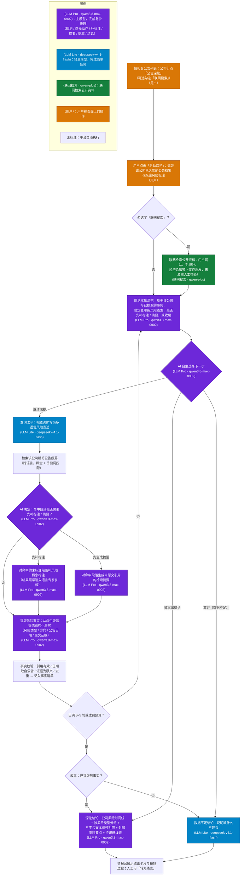
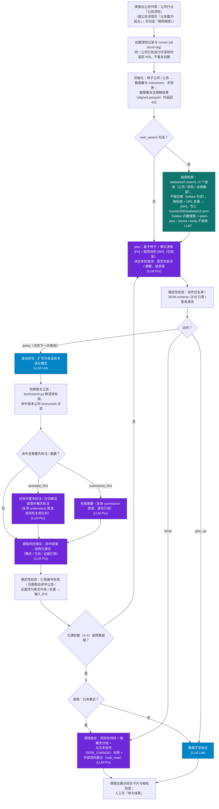

# 情报台「公告深挖」循环设计（公告 → 风险事实 → 决策，WF-04）

> 状态：设计稿。演示用第四条 agentic workflow：给定一家公司的公告，Agent 在**最多 3–5 轮**内
> 自行决定检索什么相关公告、从中提取哪些风险事实、何时收尾，产出该公司的风险画像。
> 与其余 workflow 的关系：WF-02 研究迭代 Agent 在**立项后**（有子任务、评估与回流），RD-Agent 在**子运行内**
> （完整挖掘循环），WF-03 在**立项前**（纯"检索 → 决策"，产出研究规格）；本条在**情报台内**
> （"检索 → 提取 → 决策"循环，产出风险画像），不进立项与研究流程，是四条里最轻、最偏演示型 RAG 的一条。
> 工具原语（搜索 / 摘要 / 标注）全部复用 `factopia/text/`，不新增检索或标注能力。
>
> 标注约定：LLM 步骤标 (LLM Pro) / (LLM Lite) / (LLM 联网搜索)；未标注的步骤均为普通编程（确定性代码）。

## 1. 主流程

### 业务设计


### 技术设计


**Agentic 特征：** 每轮 `plan` 都基于上一轮自己提取出来的事实清单做决策——下一轮查什么、要不要先补标注 /
摘要、事实够不够、要不要放弃——轮数不固定（1–5 轮），由 LLM 的动态决策驱动；上限、预算与事实校验由确定性代码兜底。

安全边界：深挖只读情报台已入库的公告数据；每条事实带公告时间戳（取自命中的 `published_at`，
代码写入，不接受模型给的时间），**不进入研究决策**；人工「转为线索」后，立项与回测照常走测试期规则。
勾选「联网搜索」时，外部资料（门户网站 / 彭博社 / 经济论坛等）仅作启发、不作为平台事实，
结论中单独呈现并提示「来源需人工核验」。

## 2. 步骤说明

### 2.1 plan（LLM Pro）

输入（提示词 `dig-planner-v1.md`）：

- 任务：从种子公司公告出发，检索相关公告并提取风险事实，证据足够时收尾生成风险画像；
- 种子 [S1]：公司名称 / instrument / 市场 / 该数据集公告数；如从公告详情页进入，另附起点公告的
  标题、发布时间、语气打分（tone / change）与概念标签；
- 事实清单 `[F#]`：每条含概念、方向、日期、正文、证据与段落引用（doc_id / 段落编号）；
- 联网资料 `[W#]`（勾选「联网搜索」时）：标题 / 来源 / 日期 / 摘要 / URL，**仅作启发**，
  可提示去公告里查哪些风险线索，但 rationale 不得引用 `[W#]`；
- 剩余轮数、工具白名单（`query` / `finish` / `give_up`，`query` 可带 `annotate_first` / `summarize_first` 开关）与说明。

输出 JSON：`{"action", "args", "rationale"}`；`rationale` 必须引用至少一条有效 `[F#]` 或种子 [S1]
（`finish` 必须引用 `[F#]`，`give_up` 除外）。

### 2.2 确定性校验

复用 WF-03 `_validate_plan` 的套路：动作白名单、JSON schema、`[F#]` / [S1] 引用有效性、查询清洗
（长度上限、去掉 `[F#]` 标记）。不合格时带原因重试一次 `plan`；再不合格强制收尾。该步骤不调用大模型。

### 2.3 查询改写（LLM Lite）

提示词 `dig-rewrite-v1.md`：把 Planner 的一句话查询扩写为检索友好的短查询 + 多语言术语变体 + 概念 ID。
代码校验概念 ID 在四类概念内、术语数上限；调用失败回退原文查询（`query_concepts` 仍做确定性概念映射），
不阻断本轮。这是主循环里唯一的 Lite 步骤——简单扩写任务，不值得用 Pro。

### 2.4 检索相关公告（普通编程）

复用 `factopia/text/search.py` 的 `search(query, datasets, concepts, limit)`：概念匹配 + 关键词匹配，
返回段落（原文 + 译文）、公告标题、公司、`published_at` / `available_at` / `effective_date`、概念命中与复核状态。
深挖限定 `datasets = [种子公司的数据集]`，命中再按 `instrument == 种子` 过滤（范围只限本公司公告，v2 扩展同市场对照）。
无命中时记录空结果、消耗本轮，不报错。

### 2.5 标注 / 摘要原语（可选，LLM Pro）

Planner 在 `query` 上开开关，命中落定后执行：

- `annotate_first`：对命中里**未标注或仅词典法**的段落调用 `understand.llm_label` 补概念标注
  （复用缓存，不进缓存的重标一次；标注结果仍进现有复核队列 BR-11）。提取可因此利用概念标签；
  引用待复核标注的事实在前端标记「待复核」。
- `summarize_first`：对命中调用现有 `search.summarize` 做逐句引用的摘要，摘要句与原文段落一并交给提取。

两者失败都回退「直接用原文提取」，不阻断本轮。

### 2.6 提取风险事实（LLM Pro）

提示词 `dig-extract-v1.md`：输入命中段落（原文 + 译文 + 概念标签如有 + 复核状态）、概念术语表、已有 `[F#]`
（避免重复提取）；输出 JSON `facts[]`，每条 `{statement, concept, direction, cites[], evidence}`，
`evidence` 必须逐字复制原文或译文片段。确定性校验（无大模型）：

- `cites` 全部是本次输入的段落编号，否则丢弃；
- 事实日期 = 引用公告的 `published_at`（代码写入，模型输出里的日期一律忽略）；
- `evidence` 必须是引用段落原文 / 译文的子串，否则丢弃；
- `concept` 必须在四类概念内，`direction` 只取 ±1；
- 按（概念 + 日期 + statement 前缀）对 `[F#]` 去重，重复的不再入列；
- 丢弃条数与原因写入本轮记录并展示（引用强制与 `summarize` 同款式，保证每条事实可回到原文段落）。

### 2.7 收尾与结论

- `finish` / 满轮且有事实 → 提示词 `dig-conclusion-v1.md`（LLM Pro）：按公告时间排序的风险时间线、
  按概念分组汇总、与该公司文本信号对照（`summary.json` 里该 instrument 的 tone / change 走势，确定性数据；
  结论必须区分「公告事实（引用 [F#]）」与「平台信号」）、外部资料要点 `web_note`（勾选联网时，
  引用 `[W#]`，前端标「来源需人工核验」）、建议继续深挖的线索；
- `give_up` / 满轮无事实 / 预算超限 → 一次 Lite 调用写数据不足结论 `{reason, evidence_gaps, suggestion}`
  （调用失败代码兜底，不阻断收尾）；
- 结论卡片显示在情报台（5 秒轮询，复用 Agent 页 Workflow 进度样式），可展开每轮轨迹与联网资料；
  「转为线索」为人工按钮（普通编程，复用现有线索创建 API，渠道 = 情报台深挖，预填结论摘要）。

### 2.8 联网搜索（可选，勾选「联网搜索」时）

首轮规划前执行（在 `web_searching` 状态）：

- 复用 `research/websearch.py`，有界检索 3 个查询：`{公司 代码}`、`{公司} 风险 诉讼 监管 负面`、
  `{公司} 业绩 展望 评级 新闻`——覆盖门户网站、彭博社、经济论坛等公开来源；深挖是定性分析，
  不限日期（`before=""` 不过滤）；
- 每个查询最多 5 条，按（标题、URL）跨查询去重，合计最多 15 条，写入 `rounds/000/websearch.json` 与 `dig.json` 的 `web` 字段；
- 结果只取标题 / 摘要 / URL / 日期 / 来源域，**仅作启发、不作为平台事实**；Planner 可用它找公告里的风险线索，
  但 rationale 只能引用 `[S1]` / `[F#]`；结论的 `web_note` 单独呈现并提示人工核验；
- bailian provider 走百炼内置搜索（`enable_search`，模型 qwen-plus）；bocha / tavily 不调用 LLM；
- 未配置搜索 key 时勾选创建返回 422（不静默跳过）；检索失败记录错误、不阻断深挖；预算超限时跳过。

## 3. 模型分工

| 步骤 | 模型 | 说明 |
|---|---|---|
| plan | **Pro**（`FACTOPIA_LLM_MODEL`，qwen3.8-max-0902） | 与 WF-02 / WF-03 Planner 一致；可选：policy 配置切 Lite 省钱 |
| 查询改写 | **Lite**（`FACTOPIA_LLM_LITE_MODEL`，deepseek-v4.1-flash） | 简单扩写；失败回退不阻断 |
| 检索 | 无 AI | `text/search.py` 概念 + 关键词匹配 |
| 标注（可选） | **Pro** | 复用 `understand`，与现有理解流程一致（有缓存） |
| 摘要（可选） | **Pro** | 复用现有 `summarize` |
| 提取风险事实 | **Pro** | 核心步骤，引用强制 |
| 深挖结论 | **Pro** | 风险画像起草（含外部资料要点 `web_note`） |
| 数据不足结论 | **Lite** | 简单总结，代码兜底 |
| 联网搜索（可选） | **联网搜索 LLM**（bailian 内置搜索，qwen-plus） | 启动时有界检索 3 个查询；bocha / tavily 不调用 LLM；费用由搜索接口直接计费，不计入深挖账本 |

费用参考：4 轮 ×（1 次 plan + 1 次改写 + 1 次提取）+ 收尾 1 次 ≈ 9 次 Pro + 4 次 Lite，
约 $0.2–0.5，1 分钟内（已标注段落走缓存时更省）；`annotate_first` / `summarize_first` 另计。

## 4. 记录与检查点

```
runtime/digs/<dig_id>/
├── dig.json            # 状态、种子、轮数、事实清单 [F#]、联网资料 web、结论、模型与 token
├── rounds/000/websearch.json   # 勾选联网时：3 个查询与去重后的结果（标题 / 摘要 / URL / 日期）
├── rounds/<n>.json     # 每轮：plan 输出、校验结果、改写、检索命中、标注/摘要、提取结果、丢弃事实
└── trace.jsonl         # kind=state / llm / tool，与 WF-02 / WF-03 trace 同格式（决策轨迹可展开展示）
```

- 状态：`queued → planning → rewriting → searching → annotating / summarizing → extracting → concluding → done / insufficient / failed / stopped`（每轮在 planning/acting 间交替）；
- 费用走现有 `runtime/llm_costs.jsonl` 账本（用途："深挖规划" / "查询改写" / "公告标注" / "检索摘要" / "风险事实提取" / "深挖结论"）；
- 轮数上限 3–5（策略可配，默认 4）；预算上限在 policy 配置（如 `$1.5`），超限强制收尾；
- 幂等：同一公司已有进行中的深挖时创建返回 409，不产生第二条记录；
- runner 取消请求（`cancel_requested`）在每个 LLM 调用前检查，取消即停止。

## 5. 演示脚本（约 2 分钟）

1. 情报台公告列表（法国真实数据）选一家公告较多的公司 → 勾选「联网搜索」（可选）→ 点「公告深挖」
   （或打开某篇公告点「以本篇为起点」）；
2. 深挖面板实时展示（5 秒轮询，复用 Agent 页 Workflow 进度样式）：
   - 勾选联网时先展示「联网资料 N 条」（门户 / 彭博 / 论坛，标"来源需人工核验"，可展开逐条查看）；
   - 第 1 轮：plan「商誉与减值线索」→ 改写 → 检索 +3 命中 → 提取 2 条事实（F1、F2，各带段落引用与原文证据）；
   - 第 2 轮：plan 引用 F1 → query「司法 / 监管」→ 提取 1 条；
   - 第 3 轮：plan 选 `annotate_first` → 对 4 个未标注段落补标注（提示"标注已进复核队列"）→ 提取 2 条；
   - 第 4 轮：plan → `finish`；
3. 结论卡片：风险时间线、按概念分组、与该公司 RISK_CHANGE 走势对照（说明"文本信号是平台数据，深挖事实带公告时间戳"）；
   勾选联网时另有「外部资料要点（来源需人工核验）」；点「转为线索」跳到线索池并自动定位到新线索；
4. **第二条演示路径（give_up）**：选只有 1–2 篇公告的公司 → 1–2 轮即收尾「数据不足」，展示结论卡片（缺什么数据、建议），说明 Agent 会"放弃"也是 agentic 决策的一部分；
5. 收尾讲解：四条 workflow 的层次——情报台内（本条，纯分析）、立项前（WF-03，检索-决策）、立项后（WF-02，研究迭代）、子运行内（RD-Agent，因子挖掘）。

## 6. 改动清单与工作量

| 改动 | 位置 | 量 |
|---|---|---|
| 循环本体（状态机 + 白名单校验 + 工具执行 + 事实校验 + 联网检索） | 新文件 `factopia/agents/dig.py`（照 `agents/brief.py`，检索/摘要/标注只做调用封装） | ~380 行 |
| plan / 改写 / 提取 / 结论提示词 | `factopia/agents/prompts/dig-planner-v1.md`、`dig-rewrite-v1.md`、`dig-extract-v1.md`、`dig-conclusion-v1.md` | 各 ~40–120 行 |
| 策略（轮数上限 / 每轮命中数 / 预算 / 白名单） | 新文件 `configs/agents/dig.yaml` + `factopia/agents/policy.py` 加 dig 段 | ~30 行 |
| runner 注册与执行 | `factopia/runner.py`：`execute()` 加 `"dig": run_dig` + `run_dig()`（照 `run_brief` 简化） | ~40 行 |
| API | `factopia/api/main.py`：`POST /api/text/dig`（body 含 web_search；同一公司进行中 409；无理解结果 422；未配置搜索 key 422）、`GET /api/text/digs` | ~130 行 |
| 联网检索日期规则 | `factopia/research/websearch.py`：`before` 为空时百炼提示词不限日期（深挖定性分析用） | ~5 行 |
| 前端 | `web/src/pages/IntelPage.tsx`：公司行「公告深挖」按钮 + 联网搜索勾选 + 深挖面板 + 联网资料 + 结论卡片 +「转为线索」（复用 AgentsPage 进度样式与现有线索创建 API） | ~330 行 |
| 红队测试 | `tests/test_digs.py`（照 `test_briefs.py` 风格，见下节） | ~360 行 |
| **不改** | `text/search.py`、`text/understand.py`、`summarize`、`signal`、复核流程、trace/费用账本、runner 并发池 | 0 |

工作量：**纯后端 PoC（runner 可跑）约 2–3 天；含 API + 前端 + 红队测试约 5–7 天**。
与 WF-03 同量级；不需要 runner 异步化的第一版可以更省：先做成 API 同步执行（每轮几秒到十几秒），
验证演示效果后再注册 runner job。

## 7. 红队用例（复用 WF-03 风格）

| 用例 | 验证 |
|---|---|
| `test_dig_rejects_unknown_action` | Planner 选择白名单外动作被拒 |
| `test_dig_plan_requires_cite` | rationale 不引用有效 `[F#]` / [S1] 被拒；finish 无 `[F#]` 引用被拒 |
| `test_dig_query_cleaned` | 查询里的年份 / `[F#]` 标记被清洗 |
| `test_dig_search_company_scoped` | 检索命中只保留种子公司公告，别家公司的段落被过滤 |
| `test_dig_extract_cites_must_exist` | 事实引用不存在的段落编号被丢弃 |
| `test_dig_extract_date_from_hit` | 事实日期取自引用公告的 `published_at`，模型编造的日期被忽略 |
| `test_dig_extract_evidence_verbatim` | 证据不是原文 / 译文片段的事实被丢弃 |
| `test_dig_extract_dedup` | 重复事实（概念 + 日期 + 正文前缀）只入列一次 |
| `test_dig_max_rounds_enforced` | 满轮后强制收尾，不产生下一次 plan |
| `test_dig_finish_requires_facts` | 无事实时 finish 被拒，强制走数据不足结论 |
| `test_dig_budget_stops` | 超预算强制收尾 |
| `test_dig_cancel_stops` | 取消请求在下一轮 LLM 调用前生效 |
| `test_dig_idempotent` | 同一公司重复点「公告深挖」不创建第二个进行中的记录 |
| `test_dig_requires_labels` | 数据集尚无理解结果（无 aligned.parquet）时创建返回 422 |
| `test_dig_annotate_reuses_labels` | 已标注段落不重复调用标注，走缓存 |
| `test_dig_web_search_gathers` | 勾选联网：启动时有界检索 3 个查询、结果去重、写入第 0 轮检查点 |
| `test_dig_web_search_unconfigured` | 未配置搜索 key 时勾选创建被拒（422），不静默跳过 |
| `test_dig_web_search_failure_continues` | 联网检索失败记录错误，不阻断深挖循环 |
| `test_dig_web_search_budget_skipped` | 预算 0 时跳过联网检索 |

## 8. 可选扩展（v1 不做）

- **Critic 评审**：提取后加一轮 Critic LLM（`FACTOPIA_LLM_CRITIC_MODEL`）复核事实一致性，与 WF-02 深度思考同款式；
- **Lite 命中性过滤**：检索命中先由 Lite 过滤无关段落再交 Pro 提取，降费降噪；
- **同市场可比公司对照**：检索范围扩到同市场同业公司，做横向风险对比；
- **跨公司事件深挖**：给定事件（如行业监管变化），在多公司公告间检索提取；
- **结论自动回流线索**：深挖结束后自动回流「情报台深挖」线索（v1 已有人工「转为线索」按钮，自动回流留待与 WF-02 同款式）。
