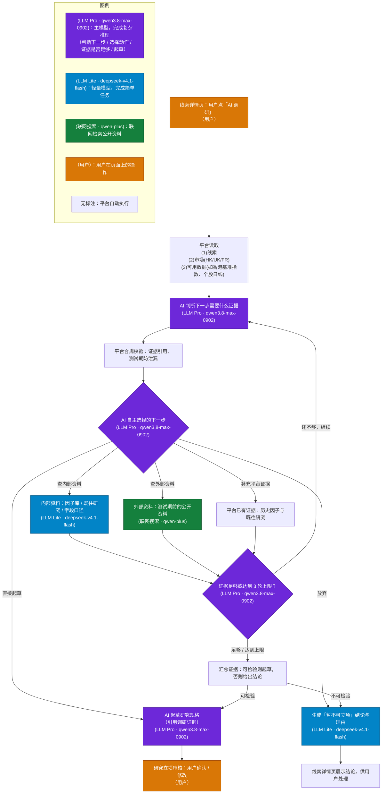
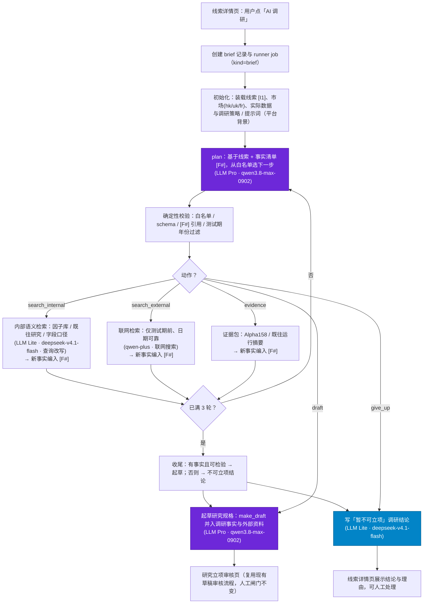
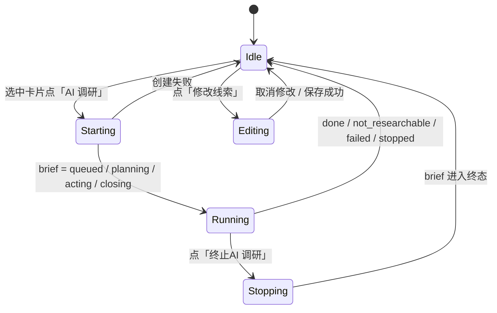

# AI 调研循环设计（线索 → 立项，WF-03）

> 状态：**已实现**（2026-11-17）。演示用第三条 agentic workflow：线索池里点「AI 调研」，Agent 在**最多 3 轮**内
> 自行决定检索什么证据、何时证据足够，最后起草研究规格（或给出「暂不可立项」结论）。
> 与前两条的关系：WF-02 研究迭代 Agent 在**立项后**（有子任务、评估与回流），RD-Agent 在**子运行内**（完整挖掘循环）；
> 本条在**立项前**（纯"检索 → 决策"循环，无子任务、无评估回流），是三者里最轻的一条。

## 1. 主流程

### 业务设计

#### 字段口径: 
数据字典,比如：
- close：收盘价，本地币种，Yahoo Finance 日线，分红拆股复权；
- volume：成交量，单位是股，拆股复权；
- benchmark：基准指数收盘，^HSI / ^FTSE / ^FCHI，Qlib 中叫 IDX_HSI / IDX_FTSE / IDX_FCHI；
- label：未来 N 日收益，从信号日下一交易日起算；
- available_at：实际可获取时间 = 收盘时刻 + 日终延迟；
- 文本信号、Alpha158、股票池、参考数据等字段也有对应口径。

#### 测试期：
factopia为了防泄漏划定的样本外回测区间，當前是2022-01 ～ 2023-12

**用戶看到的效果：** 用戶只需选择一条线索并点击「AI 调研」；AI 自行决定查内部资料、外部资料还是补充平台证据，最多 3 轮，最后给出可立项的研究规格草稿或「暂不可立项」结论。所有结果进入研究立项审核，由用戶确认或修改。

> 模型标识：**LLM Pro** = `qwen3.8-max-0902`；**LLM Lite** = `deepseek-v4.1-flash`；**联网搜索** = `qwen-plus`（当前 bailian provider）。未标注步骤为平台确定性流程。
>
> 业务视图按每一步分别标注 AI；实现上 `P / T / R` 属于同一轮 Planner 输出，`R` 中的“达到 3 轮上限”是平台确定性约束。补充平台证据来自 Alpha158 测试期前统计与既往运行摘要，不调用 LLM。

| 步骤 | 模型 | 用途 |
|---|---|---|
| P / T / R | qwen3.8-max-0902 | Planner 判断下一步、选择分支、判断证据是否足够 |
| E1 查内部资料 | deepseek-v4.1-flash | 只做中英法检索词改写，随后 BM25 检索 |
| E2 查外部资料 | qwen-plus | bailian 联网搜索；bocha/tavily 模式不经过聊天模型 |
| DR 起草研究规格 | qwen3.8-max-0902 | 生成研究规格草稿 |
| GU 暂不可立项结论 | deepseek-v4.1-flash | 生成结论与理由 |

### 技术设计

> 保留实现细节：brief 记录与 runner job、初始化数据来源、schema / 白名单校验、LLM 分层与 `make_draft`。
> 标注约定：LLM 步骤标 (LLM Pro) / (LLM Lite)；未标注的步骤均为普通编程（确定性代码）。
> 技术实现中 R（是否满 3 轮）是确定性检查；业务视图把“证据是否足够”作为 AI 决策步骤标注。



**Agentic 特征：** 每轮 `plan` 都基于上一轮自己检索回来的事实清单做决策——选哪个工具、查什么、
查够了没有、要不要放弃——轮数不固定（1–3 轮），由 LLM 的动态决策驱动；上限与校验由确定性代码兜底。

### 1.1 初始化数据从哪里来

图中“初始化”不是从外部实时拉取，而是在创建 brief 时把线索快照进 `brief.json`，之后每轮 plan 再组装提示词：

| 内容 | 来源 | 说明 |
|---|---|---|
| 线索 `[I1]` | `factopia/ideas/__init__.py::detail(iid)` | API `POST /api/ideas/{iid}/brief` 读取线索后，`brief.create()` 快照 `title / body / channel / markets / ai_hypothesis / direction` 到 `brief.json`；后续线索被改也不会改变已启动的调研 |
| 市场 | 线索的 `idea.markets` | 过滤 `VALID_MARKETS`；为空时默认 `hk / uk / fr`；`evidence` 和 `draft` 动作可再覆盖本次使用的市场 |
| 数据可得性表 | `factopia/research/draft.py` 的 `DATA` 常量 | 由 `brief._data_text()` 每轮渲染成 available / NOT available；不是实时数据目录。当前只有日线行情与基准指数可用，财务、另类数据未接入，文本数据有授权/样本期限制 |
| 调研策略 | `configs/agents/brief.yaml` → `policy.load_brief()` | 轮数上限（3）、预算（$0.5）、默认授权、horizon、工具白名单、提示词版本；创建时存入 `brief.json` 的 `policy` |
| 平台背景 / 规则 | `factopia/agents/prompts/brief-planner-v1.md` | 角色说明、平台数据边界、防泄漏规则（查询不得含 2022+ 年份）、引用规则、动作 JSON schema；与 `DATA`、工具白名单一起构成 Planner 的“平台背景” |

因此，“平台背景”不是单独的一份数据库，而是 **策略配置 + 提示词模板 + 数据可得性常量** 的组合。

## 2. 步骤说明

### 2.1 plan（LLM Pro）

输入（提示词 `brief-planner-v1.md`）：

- 调研任务：判断线索能否立项；能立项则补齐证据后起草规格，不能则说明原因；
- 线索：标题、正文、渠道、AI 假设（如有）、市场（线索本身作为可引用事实 **[I1]**）；
- **数据可得性表**（确定性，`research/draft.py` 的 `DATA`）：明确告诉 Planner 什么数据没有——
  例如线索依赖基本面数据时应当直接 `give_up`，而不是空转检索；
- 事实清单 `[F#]`：每条含来源（内部 / 外部 / 证据包）、标题、摘要、日期；
- 剩余轮数、工具白名单与说明。

输出 JSON：`{"action", "args", "rationale"}`；`rationale` 必须引用有效引用——`[I1]`（线索本身）或 `[F#]`（已收集事实）；
其中 `draft` 必须引用至少一条 `[F#]`（保证起草前至少做过一轮检索）；`give_up` 引用可选。

### 2.2 确定性校验

复用 WF-02 `_validate_plan` 的套路：工具白名单、JSON schema、`[F#]` 引用有效性、`args` 中 2022+ 年份清洗。
不合格时带原因重试一次 `plan`；再不合格强制收尾。该步骤不调用大模型。

### 2.3 工具执行（全部复用现有模块）

| 动作 | 执行 | 产出 |
|---|---|---|
| `search_internal` | `research.semantic.search`（复用 `draft.internal_knowledge`） | 因子库 / 既往研究 / 字段口径条目，去掉 2022+ 年份后编入 `[F#]` |
| `search_external` | `research.websearch`（复用 WF-02 联网搜索：`FACTOPIA_SEARCH_BEFORE` 前、日期可靠） | 标题 / 摘要 / URL / 日期编入 `[F#]` |
| `evidence` | `evidence.alpha158_findings` + `evidence.past_runs` | 证据包摘要编入 `[F#]`（MINE-11：只有名称与说明） |
| `draft` | `research.draft.make_draft`（LLM Pro） | 研究规格草稿，`external_evidence` 并入调研的外部事实（≤8 条），`idea_id` 指向线索 |
| `give_up` | 一次 Lite 调用写结论（LLM Lite） | `{reason, evidence_gaps, suggestion}` 存入 brief 记录 |

### 2.4 收尾与人工闸门

- 每轮检索后轮数 +1；满 3 轮强制收尾：事实清单非空且假设可检验 → 强制走 `draft`；否则走 `give_up`；
- `draft` 产出的草稿进入**现有研究立项审核页**，人工审核 / 修改 / 立项的流程完全不变；
- `give_up` 的结论显示在线索详情页，不自动创建任何研究或线索。

## 3. 模型分工

| 步骤 | 模型 | 说明 |
|---|---|---|
| plan | **Pro**（`FACTOPIA_LLM_MODEL`，qwen3.8-max-0902） | 与 WF-02 Planner 一致；可选：policy 配置切 Lite 省钱 |
| draft | **Pro** | `make_draft` 用主模型，与现有立项起草一致 |
| give_up 结论 | **Lite**（`FACTOPIA_LLM_LITE_MODEL`，deepseek-v4.1-flash） | 简单总结任务 |

单次调研费用参考：3 轮 plan + 1 次 draft ≈ 4 次 Pro 调用 + 至多 1 次 Lite，演示成本约 $0.1 级，时长约 1 分钟内。

## 4. 记录与检查点

```
runtime/briefs/<brief_id>/
├── brief.json          # 状态、轮数、事实清单 [F#]、结论、模型与 token
├── rounds/<n>.json     # 每轮：plan 输出、校验结果、执行结果、新增事实
└── trace.jsonl         # kind=state / llm / tool，与 WF-02 trace 同格式（决策轨迹可展开展示）
```

- 状态：`queued → planning → acting → drafting → done / not_researchable / failed`（每轮在 planning/acting 间交替）；
- 费用走现有 `runtime/llm_costs.jsonl` 账本（用途："调研规划" / "研究规格起草" / "调研结论"）；
- 预算上限在 policy 配置（如 `$0.5`），超限强制收尾；
- runner 取消请求（`cancel_requested`）在每个 LLM 调用前检查，取消即停止。

## 5. 演示脚本（约 2 分钟）

1. 打开线索池，选一条**量价类**演示线索 → 点「AI 调研」；
2. 调研面板实时展示（5 秒轮询，复用 Agent 页 Workflow 进度样式）：
   - 第 1 轮：plan → 内部检索，+3 条事实；
   - 第 2 轮：plan → 联网检索，+2 条事实（页面提示"来源需人工核验"）；
   - 第 3 轮：plan → `draft`；
3. 点「去审核」跳研究立项审核页：展示草稿的假设 / 方向 / 数据需求 / 待确认事项，说明"证据来自 AI 调研，可在线索页回看每轮轨迹"；
4. **第二条演示路径（give_up）**：选一条依赖基本面数据的线索 → 第 1–2 轮即 `give_up`，展示结论卡片（数据未接入、建议方向），说明 Agent 会"放弃"也是 agentic 决策的一部分；
5. 收尾讲解：三条 workflow 的层次——立项前（本条，检索-决策）、立项后（WF-02，研究迭代）、子运行内（RD-Agent，因子挖掘）。

## 6. 改动清单与工作量

| 改动 | 位置 | 量 |
|---|---|---|
| 循环本体（状态机 + 白名单校验 + 工具执行） | 新文件 `factopia/agents/brief.py`（照 `agents/loop.py` 精简） | ~250 行 |
| plan / give_up 提示词 | `factopia/agents/prompts/brief-planner-v1.md`、`brief-conclusion-v1.md` | 各 ~100 行 |
| 策略（轮数上限 / 工具白名单 / 预算） | `factopia/agents/policy.py` 加 brief 段 | ~20 行 |
| runner 注册与执行 | `factopia/runner.py`：`execute()` 加 `"brief": run_brief` + `run_brief()`（照 `run_agent` 简化） | ~40 行 |
| API | `factopia/api/main.py`：`POST /api/ideas/{iid}/brief`、`GET /api/ideas/{iid}/brief`（进行中幂等 409） | ~120 行 |
| 前端 | `web/src/pages/IdeasPage.tsx`：按钮 + 调研面板 + 结论卡片；复用 AgentsPage 进度样式 | ~250 行 |
| 红队测试 | `tests/test_agents_p1.py` 风格（见下节） | ~300 行 |
| **不改** | 审核页、`make_draft`、`websearch`、语义检索、trace/费用账本、runner 并发池 | 0 |

工作量：**纯后端 PoC（CLI 可跑）约 2–3 天；含 API + 前端 + 红队测试约 5–7 天**。
不需要 runner 异步化的第一版可以更省：先做成 API 同步执行（每轮几秒到十几秒），验证演示效果后再注册 runner job。

## 7. 红队用例（复用 WF-02 风格）

| 用例 | 验证 |
|---|---|
| `test_brief_rejects_unknown_tool` | Planner 选择白名单外工具被拒 |
| `test_brief_plan_requires_cite` | rationale 不引用有效 `[F#]` 被拒 |
| `test_brief_query_year_cleaned` | 查询里的 2022+ 年份被清洗（MINE-11） |
| `test_brief_max_rounds_enforced` | 3 轮后强制收尾，不产生第 4 次 plan |
| `test_brief_give_up_on_missing_data` | 依赖未接入数据的线索走 give_up，不编造事实 |
| `test_brief_idempotent` | 同一线索重复点「AI 调研」不创建第二个进行中的 brief |
| `test_brief_budget_stops` | 超预算强制收尾 |
| `test_brief_cancel_stops` | 取消请求在下一轮 LLM 调用前生效 |

## 8. 实现记录（2026-11-17）

- 后端：`factopia/agents/brief.py`（循环本体 + 存储 + 白名单校验）、`factopia/agents/prompts/brief-planner-v1.md`、`brief-conclusion-v1.md`、`factopia/agents/policy.py` 的 `load_brief()`、`configs/agents/brief.yaml`、`factopia/runner.py` 的 `run_brief` + `recover`/`init_dirs` 接入、`factopia/research/store.py` 的 `create_brief_job`、`factopia/api/main.py` 的 `POST /api/ideas/{iid}/brief` 与 `GET /api/ideas/{iid}/brief`；
- 前端：`web/src/api.ts`（`ideaBriefCreate` / `ideaBrief` + 类型）、`web/src/pages/IdeasPage.tsx`（选中卡片 footer 的「AI 调研 / 终止AI 调研」、BriefPanel 轮次时间线 / 事实清单 / 草稿摘要 / 结论卡片、`researchingId` 单一状态 + `sessionStorage` 刷新恢复、运行中 5 秒轮询）、三个 i18n 文件；
- 线索卡片交互：编辑与调研互斥；调研中锁定其他线索及搜索/筛选；启动后自动滚动到 `#idea-brief`；BriefPanel 只展示输出，不再重复提供启动按钮（详见第 9 节）；
- 测试：`tests/test_briefs.py` 14 个用例（含红队：白名单外工具拒绝、无引用拒绝、年份清洗、满轮收尾、预算停止、取消、幂等），全部通过；`tests.test_agents` / `test_agents_p1` 33 个现有用例回归通过；
- 前端构建：`npm run build` 通过；`web/dist` 已更新；
- 冒烟测试（真实 LLM）：对 WF-02 演示线索 `idea_20261114202859_963f` 启动调研 → 第 1 轮内部检索 +8 事实 → 第 2 轮 `give_up`（正确识别"依赖公告文本数据、平台不可得"）→ Lite 写结论，23 秒完成，费用 $0.002。

## 9. 线索卡片交互与锁定设计（2026-11-17）

### 9.1 目标

- 「AI 调研」与「修改线索」保持一致的入口位置：只在该线索被选中时显示；
- 同一时间只允许一个动作：**编辑线索**或**AI 调研**，避免一边改一边调研；
- 启动后自动定位到调研输出，用户能立即看到进度；
- 前端用**一个状态**表达“哪条线索正在调研”，而不是每张卡片各自维护布尔值。

### 9.2 按钮与可见性

选中线索卡片的 footer：

```text
[修改线索] [AI 调研]          ← 空闲
[修改线索(disabled)] [终止AI 调研]  ← 调研中
```

- 「修改线索」：仅 `active && editable` 显示；
- 「AI 调研」：仅 `active` 显示；点击后选中该线索并启动；
- 调研中：AI 按钮隐藏，替换为 **「终止AI 调研」**；点击调用取消接口，按钮显示 **「终止中…」**；
- 详情区 `BriefPanel` **不再提供「启动 AI 调研」/「重新调研」**，只负责展示进度、轮次、事实与结论，避免与卡片按钮重复；
- 点击 AI 调研后自动滚动到 `#idea-brief`（调研输出 div）；详情尚未渲染时短轮询重试，最多约 2 秒。

### 9.3 前端状态机



核心状态：

```ts
const [editing, setEditing] = useState<IdeaDetail | null>(null);
const [researchingId, setResearchingId] = useState<string | null>(null);
const [stoppingResearch, setStoppingResearch] = useState(false);
const locked = !!editing || !!researchingId;
```

- `researchingId` 存正在调研的线索 id；
- `null` 表示没有任何线索在调研；
- `locked` 同时驱动卡片点击、勾选、搜索、AI 查询和状态/市场筛选。

### 9.4 锁定规则

| 当前状态 | 选中线索的「修改线索」 | 选中线索的「AI 调研」 | 其他线索 | 搜索 / 筛选 | 详情区 |
|---|---|---|---|---|---|
| 空闲 | 可用 | 可用 | 可用 | 可用 | 可查看 / 转立项 |
| 编辑中 | 显示「取消修改」，可用 | 禁用 | 全部锁定 | 禁用 | 编辑表单 |
| 调研中 | 禁用 | 显示「终止AI 调研」 | 全部锁定 | 禁用 | BriefPanel 输出 |
| 终止中 | 禁用 | 显示「终止中…」，禁用 | 全部锁定 | 禁用 | 等待终态 |

编辑态下「取消修改」必须保持可点击；锁定的目的是禁止开始新动作，不是把用户困在编辑里。

### 9.5 启动、终止与刷新恢复

- 启动：卡片按钮 → 若该线索已有运行中的 brief，直接复用；否则 `POST /api/ideas/{id}/brief`；
- 轮询：每 5 秒 `GET /api/ideas/{id}/brief`，进入终态后清空 `researchingId` 并解锁；
- 终止：`POST /api/jobs/{job_id}/cancel`；成功后保持「终止中…」，轮询到终态再解锁；15 秒未停止则恢复按钮，允许重试；
- 刷新恢复：`researchingId` 同时写入 `sessionStorage`（`factopia-researching-idea`）；页面加载时读取并调用 `GET /api/ideas/{id}/brief` **校验后端状态**，只有确实在运行才恢复锁定，否则清除；
- `sessionStorage` 按标签页隔离。多标签页同步需要改用 URL 参数或后端“运行中 brief”查询；当前单页场景足够。

### 9.6 边界

- 创建失败 / 轮询连续失败约 30 秒：解锁并显示错误；
- 调研完成 / 暂不可立项 / 失败 / 已停止：自动解锁，卡片恢复「AI 调研」；
- 编辑中启动调研、调研中点击其他线索、调研中搜索：均被阻止；
- 启动接口本身对同一线索幂等（已有进行中的 brief 返回 409），前端先查询再创建，避免重复任务。

## 10. 可选扩展（v1 未做）

- **Critic 评审**：plan 后加一轮 Critic LLM（`FACTOPIA_LLM_CRITIC_MODEL`）评审证据充分性，与 WF-02 深度思考同款式；
- **plan 切 Lite**：policy 可配，进一步降费；
- **调研摘要回写线索**：brief 结束后把事实清单摘要写回线索的 `ai_hypothesis` / 备注，供人工转立项时参考。
