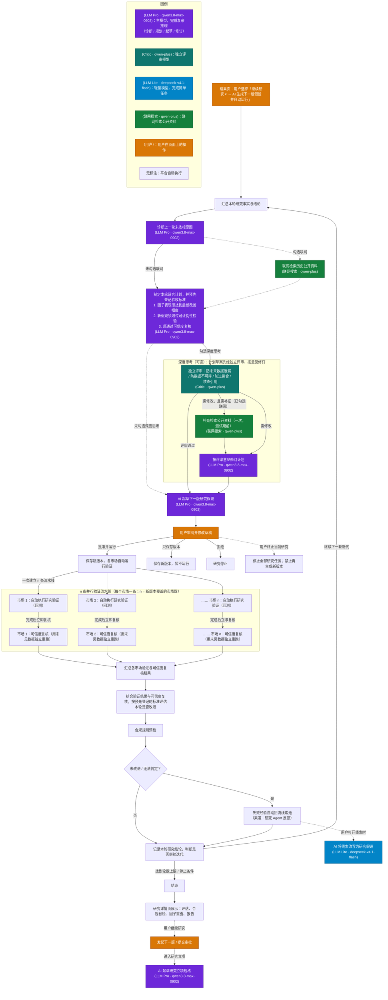
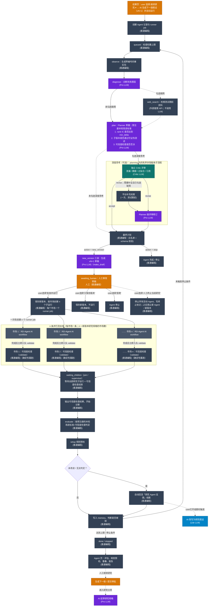
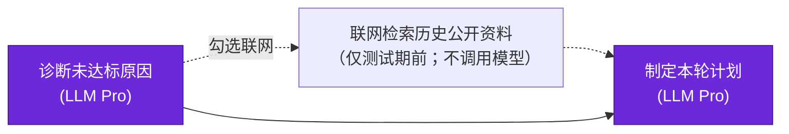
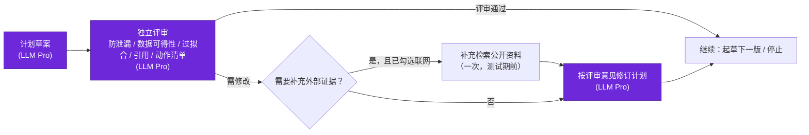

# 研究迭代 Agent 演示脚本（WF-02）

> 适用版本：2026-11-15。演示数据使用 runtime 中已完成的 Agent `agt_20261114181750_cdfa`；
> 不需要重跑 UK（UK 单轮约 17 分钟，演示时不要现场等待）。

## 0. 预置条件

```powershell
docker compose -f docker-compose.yml -f compose.local.yml --profile platform --profile research up -d
```

- Web：<http://localhost:18080>
- Vite 热更新：<http://localhost:5173>
- Agent 列表：<http://localhost:18080/agents>
- 固定演示 Agent：<http://localhost:18080/agents/agt_20261114181750_cdfa>

演示用固定记录：

| 项 | 值 |
|---|---|
| 根研究 | `hk_uk_fr_tone_cntp_interaction` v1 |
| Agent 当前版本 | v3 |
| 评估 | `not_improved` |
| 规则预检 | 阻断 0 / 警告 3 / 提示 4 |
| 自动回流线索 | `idea_20261114202859_963f`（渠道：研究 Agent 反馈） |
| 子运行 | HK / UK / FR 各 2 轮 + 3 个可信度检查 |

---

## 0.1 新 Agent 工作流与模型分工

模型由 `.env` 控制：

- **LLM Pro（主模型）** = `FACTOPIA_LLM_MODEL`，当前为 `qwen3.8-max-0902`（规划 / 起草 / 诊断 / 修订等复杂任务）
- **LLM Lite（轻量模型）** = `FACTOPIA_LLM_LITE_MODEL`，当前为 `deepseek-v4.1-flash`（简单任务）
- **Critic（评审模型）** = `FACTOPIA_LLM_CRITIC_MODEL`，当前为 `qwen-plus`（深度思考的独立评审；未配置或 403 回退主模型）
- **联网搜索** = `FACTOPIA_SEARCH_PROVIDER=bailian` + `FACTOPIA_SEARCH_MODEL=qwen-plus`（百炼内置搜索；bocha / tavily 不调用 LLM）
- **向量模型** = `EMBEDDING_MODEL`，当前为 `openai/text-embedding-v4`（平台资料 / 语义检索用；本迭代流程不直接调用）
- **普通编程** = 确定性代码 / 文件 / 队列，不调用大模型
- **用户操作** = 页面上的审改、批准、终止等人工操作

### 业务设计

> 面向金融业客户阅读。图中每个 AI 步骤都标注了所用模型类型与具体模型；未标注的步骤由平台自动执行，不调用 AI。



补充说明：

- 平台共使用 5 类模型：**主模型（LLM Pro）**、**轻量模型（LLM Lite）**、**评审模型（Critic）**、**联网搜索**、**向量模型**；其中向量模型用于平台的资料检索场景，本迭代流程不直接调用。
- 评估、合规预检、因子重叠 / 互补、报告等环节由平台确定性规则完成，不调用 AI，保证结果可复现、可审计。
- 深度思考为可选：开启后计划草案先经独立评审再定稿，更严谨、也更耗时。
- 计划也可能直接决定结束研究（如问题已解决或不值得继续）。

### 技术设计

> 面向开发人员。节点标注为模型类型（不标注具体模型）；`(普通编程)` 为确定性代码路径。



**说明：**

- 图中 `action = new_version` 是主演示路径；Planner 也允许 `run_rdagent` / `run_text` / `validate` / `diagnose` / `stop`，这些动作由普通编程 / runner 执行，不额外调用 Pro/Lite 模型；其中 `run_rdagent` / `run_text` 的子任务内部使用 RD-Agent 的 `CHAT_MODEL`。
- **联网**和**深度思考**都是 `planning` 阶段内的同步子流程，**不创建 runner job**：联网是 `diagnose → plan` 之间的可选检索（外部搜索 API，不调用 LLM）；深度思考是 `plan` 内部的 Planner → Critic → 修订（最多一轮）。它们与 `waiting_children` 里真正的 RD-Agent 子任务不同，后者是独立 runner job。
- 图中 `F2` 是经过 `_validate_plan`（工具白名单 + JSON schema + rank IC 方向一致性）的最终计划；未勾选深度思考时 `F` 直接到 `F2`，勾选后 Critic `accept` 或修订完成再到 `F2`。
- 人工批准并运行后，会**按研究规格的市场数 n 一次性创建 n 个 runner job**（每个市场一条独立 RD-Agent workflow）。每个市场的 RD-Agent 完成后，runner 立即为该市场入队可信度检查（validate）；因此 n 条「RD-Agent → validate」流水线并行推进，validate 可以和其它市场的 RD-Agent / validate 重叠执行。所有 job 共用 runner 并发池（默认 3 个槽），超出排队。
- Agent 进入 `waiting_children`，作为 join / supervisor 等待全部研究子运行 + 可信度检查结束，不占 runner 运行槽；没有采纳轮次的市场不会创建 validate。
- 草稿是在人工闸门**之前**由 Pro LLM 生成的；人工批准后才保存版本并创建子运行。
- `evaluate`、规则预检、重叠 / 互补、报告、去重与记忆全部是确定性代码，不调用大模型。
- 自动回流线索的创建是(普通编程)；打开该线索时，前端会请求 AI 改写为研究假设，使用 Lite LLM。
- 「终止当前研究」可以在结果页或 Agent 页随时执行；图中只画在人工闸门处作为示例。终止会停止所有活动 Agent，并禁止该研究再启动 Agent 或生成新版本。

### 模型分工速查

| 步骤 / 任务 | 执行方式 | 模型 |
|---|---|---|
| 结果页「AI 生成下一版假设（vN+1）并自动运行」入口 | 人工操作 | 无 AI |
| 创建 Agent 与 runner job | (普通编程) | 无 AI |
| queued / 轮数检查 | (普通编程) | 无 AI |
| observe 事实包 | (普通编程) | 无 AI |
| diagnose 诊断 | AI | **Pro LLM** |
| plan 规划与预注册标准 | AI | **Pro LLM** |
| new_version 生成 vN+1 草稿 | AI | **Pro LLM** |
| 人工审改、批准 / 拒绝 / 终止 | 人工 | 无 AI |
| 保存版本、按市场创建 n 个子运行 | (普通编程) | 无 AI；每个市场一个 runner job |
| RD-Agent 子运行 × n（每市场一条） | 外部运行 | RD-Agent 的 `CHAT_MODEL`（不是 Pro/Lite）；runner 按并发上限调度（当前最多 3 个） |
| waiting_children（join / supervisor） | (普通编程) | 无 AI；等待全部研究子运行 + 可信度检查结束，不占 runner 运行槽 |
| 可信度检查（validate）× n | (普通编程)（确定性重跑） | 无 AI；每个市场 RD-Agent 完成后立即入队，n 条流水线并行（受 runner 并发上限 3 约束） |
| 导出、补诊断 | (普通编程) | 无 AI |
| evaluate 评估 | (普通编程)（确定性指标） | 无 AI |
| setup 规则预检 | (普通编程) | 无 AI |
| 自动回流线索 | (普通编程) | 无 AI |
| 打开回流线索并 AI 改写研究假设 | AI | **Lite LLM** |
| 因子库重叠 / 互补结论 | (普通编程)（`portfolio.combine`） | 无 AI |
| 迭代报告 | (普通编程) | 无 AI |
| 结果页「生成下一版」的 AI 起草 | AI | **Pro LLM** |
| 语义检索查询改写 | AI | **Lite LLM** |
| 术语表候选建议 | AI | **Lite LLM** |
| 公告标注 / 检索摘要 / AI 解释 | AI | **Pro LLM** |
| 线索 AI 建议 / 合并 / 论文因子抽取 | AI | **Pro LLM** |
| Agent 联网搜索（勾选时） | 外部搜索 API / 百炼内置搜索 | bailian 用 `qwen-plus` 联网；bocha/tavily 不调用 LLM；只取测试期前、日期可靠的结果 |
| 深度思考 Critic | AI | **Critic LLM**（`FACTOPIA_LLM_CRITIC_MODEL`） |
| 深度思考 Planner 修订 | AI | **Pro LLM** |
| 研究立项外部资料检索 | 人工触发 + 搜索 | bailian 用 `qwen-plus` 联网；bocha/tavily 不调用 LLM；AI 起草用 **Pro LLM**（`rs-draft-v4`） |

---

## 0.2 可选增强编排：联网搜索与深度思考

结果页「继续研究 ▾ → AI 生成下一版假设（vN+1）并自动运行」下新增两个勾选项：

| 选项 | 默认 | 作用 |
|---|---|---|
| **联网** | 不勾选 | 只在勾选时，Agent 在 `diagnose` 后、`plan` 前调用联网搜索；未配置搜索 key 时拒绝启动 Agent |
| **深度思考** | 不勾选 | 规划 → 独立评审 → 修订（最多一轮），更慢、更贵 |

### 0.2.1 联网搜索



安全边界：

- 只采用测试期（2022）以前的公开资料；默认截止 `2021-12-31`，日期未知默认排除；
- 网页内容是不可信输入，只取标题、摘要、URL；不执行网页指令，也不作为平台事实；
- 外部资料可以启发 `args.changes`，但规划理由仍必须引用 `[F#]`；外部来源写作 `[W#]`；
- Agent 页每轮可展开「联网检索 · N 条结果」；结果写入 `rounds/<n>/external.json`；
- **bailian** provider 的 URL/日期由模型整理，页面会提示「来源需人工核验」；不要把其当作平台事实；
- 无搜索 key 时，勾选联网创建 Agent 会返回 422，不会静默跳过。

配置：

```env
# 当前环境只有百炼 key：用百炼内置搜索
FACTOPIA_SEARCH_PROVIDER=bailian
FACTOPIA_SEARCH_MODEL=qwen-plus
FACTOPIA_SEARCH_BEFORE=2021-12-31
# FACTOPIA_SEARCH_API_KEY 仅 bocha / tavily 需要；bailian 复用 FACTOPIA_LLM_API_KEY

# 如另有博查 / Tavily key，可改为：
# FACTOPIA_SEARCH_PROVIDER=bocha
# FACTOPIA_SEARCH_API_KEY=...
# 或 FACTOPIA_SEARCH_PROVIDER=tavily
```

- **bailian** 使用现有 `FACTOPIA_LLM_API_KEY` 与 `FACTOPIA_LLM_BASE_URL`，不需要额外 key；
- 百炼内置搜索的 URL/日期由模型整理，不是搜索引擎原始结构化结果；页面会提示“来源需人工核验”；
- 博查：<https://open.bochaai.com>；Tavily：<https://tavily.com>
- 修改 provider/key 后需重启 **api 和 runner**（研究立项页在 api 调用，Agent 联网在 runner 调用）。

研究立项页还有人工可选的「外部资料检索」：搜索、勾选最多 8 条，随「AI 起草研究规格」发送；使用提示词 `rs-draft-v4`，审核页显示外部资料清单。外部资料仅作灵感，不改变平台判定。

### 0.2.2 深度思考（独立评审 + 修订）



- 规划 / 修订用 `FACTOPIA_LLM_MODEL`（主模型）；评审用 `FACTOPIA_LLM_CRITIC_MODEL`（当前 `qwen-plus`），未配置或 403 回退主模型（图中评审按 LLM Pro 归类）；
- 一个规划轮次内：Planner 一次 → Critic 一次 →（`revise` 时）Planner 修订一次；不是无限辩论；
- Critic 可返回 `needs_external_search` + `search_query`；只有 `verdict=revise` 且 Agent 启动时勾选联网，平台才执行**一次**补充检索；
- 补充检索的查询由平台清洗（去掉 2022+ 年份和 `[F#]/[W#]` 标记），仍只取 `FACTOPIA_SEARCH_BEFORE` 之前、日期可靠的结果；结果写入 `rounds/<n>/external_revision.json`，并入修订 prompt；trace 记 `web_search phase=revision`；
- Critic 检查：2022+ 泄漏、数据不可得、不可检验 / 过拟合、与历史尝试重复、`F#` 引用、单动作白名单；
- 修订后的计划仍走 `_validate_plan` 白名单与 schema 校验；
- Critic、补充检索或修订失败时保留原计划，不阻断本轮；
- 评审问题、要求修改项、是否修订、补充检索来源显示在 Agent 页；写入 `rounds/<n>/plan_critique.json`；
- 开启后至少多 1–2 次 LLM Pro 调用，耗时和费用更高。

> **它算 sub-workflow 吗？** 算，但是 `planning` 状态内的**同步子流程**：Planner / Critic / 修订都在同一次 Agent 推进中完成，不创建 runner job、不占 runner 并发槽；这与 `waiting_children` 下按市场创建的 RD-Agent 子任务（独立 runner job）是不同层级。联网检索同理，是 `diagnose → plan` 之间的同步子流程。

### 0.2.3 相关文件与验证

- 后端：`factopia/research/websearch.py`、`factopia/agents/loop.py`、`factopia/agents/prompts/iteration-planner-v2.md`、`iteration-plan-critic-v1.md`、`factopia/research/prompts/rs-draft-v4.md`
- 前端：`web/src/components/StudyPanel.tsx`、`web/src/pages/ResearchPage.tsx`、`web/src/pages/AgentsPage.tsx`
- 配置：`.env` / `.env.example` 的 `FACTOPIA_SEARCH_*`
- 测试：50 个单测通过（3 个需要 rdagent 镜像的用例跳过）；前端 `npm run build` 通过。

---

## 0.3 Agent 页 Workflow 进度

点击结果页「AI 生成下一版假设（vN+1）并自动运行」后，平台会创建 Agent 并自动跳转到 **研究 Agent 页的具体 Agent**（`/agents/<agent_id>`）。Agent 页在「运行概览」下方新增 **Workflow 进度** section，显示**当前轮**每一步在做什么、结果是什么。

步骤顺序：

1. 观察事实
2. 诊断问题
3. 联网检索（仅勾选联网时显示）
4. 规划下一步
5. 深度思考评审（仅勾选深度思考时显示）
6. 生成下一版草稿
7. 人工批准
8. 运行新版本
9. 可信度检查
10. 评估与回流
11. 本轮结束 / 下一轮

每一步显示：

- 状态：已完成 / 进行中 / 等待 / 失败 / 跳过；
- 结果摘要：
  - 事实数、平台结论、迁移分类；
  - 诊断原因与置信度；
  - 外部资料条数与截止日期；
  - 计划动作与预期结果；
  - Critic 结论、实际模型、是否按评审修订；
  - 草稿标题；
  - 审批人、版本、自动运行 / 只保存版本；
  - 评估结论、规则预检计数、自动回流线索；
  - 本轮停止原因或下一轮状态。

RD-Agent 运行步骤按市场显示业务状态，不显示 RD-Agent 日志：

- `香港市场正在运行中`
- `香港市场已完成运行`
- `香港市场运行失败`
- `伦敦 / 法国` 同理（界面使用现有市场名称：香港 / 英国 / 法国）

可信度检查同样按市场显示：排队中 / 进行中 / 已完成 / 失败。

> RD-Agent 原始日志请在「04 运行中」查看；Workflow 进度只显示流程状态与结果。下方「子运行表」仍保留运行编号与查看过程 / 查看结果链接。

运行中的 Agent 每 5 秒自动刷新；停止后显示最终 Workflow 状态。

### 0.3.1 AI 生成与决策轨迹

- Workflow 上方新增控制区，两个按钮分别展开 / 收起下方 section；
- **显示决策轨迹**：展开完整 trace（状态迁移、工具调用、全部 LLM 调用），内容高度 10rem、可上下滚动；按钮变为 **隐藏决策轨迹**；
- **显示生成下一个AI的思考过程**：展开 / 收起 **「AI生成假设，思考中...」** Workflow section；按钮变为 **隐藏生成下一个AI的思考过程**；
- 两个 section 可独立展开；决策轨迹 section 位于 AI 生成 section 下方；
- 草稿生成（`role=draft`）现在也会写入 trace，不再只有 token 用量；
- 「深度思考评审」步骤显示 Critic 结论、模型、是否按评审修订，以及「补充检索 N 条」；展开后可查看补充来源；
- 完整原始日志仍保存在 `runtime/agents/<id>/trace.jsonl`。

---

## 1. 主演示：负结果如何闭环（约 3 分钟）

### 1.1 打开 Agent 页

打开：

```
http://localhost:18080/agents/agt_20261114181750_cdfa
```

展示：

1. 顶部状态 **已停止**；根研究、当前版本 v3、费用、审批人；
2. **Workflow 进度**：当前轮每一步的状态与结果；运行 / 可信度检查按市场显示「香港市场正在运行中 / 已完成运行」等业务状态，不显示 RD-Agent 日志；
3. **子运行表（6 行）**：3 个 RD-Agent 运行 + 3 个可信度检查，状态与运行编号；
4. **评估面板**：`not_improved`，父/子版本 rank IC、扣成本收益、最大回撤；
5. **规则预检**：阻断 0 / 警告 3 / 提示 4，建议审批路径；
6. **因子库重叠**：当前 v3 与历史/已获批版本的相关性，≥0.7 标红“冗余”，并给出互补结论；
7. **下一步**：查看结果 / 基于 v3 继续研究 / 查看已自动回流的线索 / 提交审批；次级入口规则预检、构建组合与报告。

### 1.2 展示自动线索回流

点击 **查看已自动回流的线索**，或打开：

```
http://localhost:18080/ideas?id=idea_20261114202859_963f
```

说明：

- 渠道：**研究 Agent 反馈**（自动渠道，平台自动提交）；
- 来源：`hk_uk_fr_tone_cntp_interaction.v3` + 运行 `hk_h20_20261114183512`；
- Agent 没有自动开新研究；线索池是人工决定是否转立项的入口。

### 1.3 展示治理交接

从 Agent 页依次指向：

| 入口 | 预期 |
|---|---|
| 规则预检 | 风控台自动选中 `id=hk_uk_fr_tone_cntp_interaction&v=3`，显示两次预检 |
| 构建组合与报告 | 组合台自动选中 v3；可构建组合、生成报告 |
| 提交审批 | 审批台自动选中 v3；前置条件未满足时会列出缺项 |
| 查看结果 | 结果页打开该市场运行，可查看逐轮、诊断、可信度 |

**一句话总结：** Agent 负责观察、诊断、规划、运行、可信度检查、评估和回流线索；规则、组合、报告、审批仍由平台确定性工具与人工完成。

---

## 2. 完整正向演示（可选，约 15–30 分钟）

UK 慢，建议用**单市场研究**做现场演示，例如 `hk_vol_price_divergence_reversal`。

1. 结果页选一个已完成运行 → 研究结论右上角 **继续研究 ▾ → AI 生成下一版假设（vN+1）并自动运行**；
   - 可选勾选 **联网**：需先在 `.env` 配置 `FACTOPIA_SEARCH_API_KEY`，Agent 会在诊断后检索测试期前的公开资料；
   - 可选勾选 **深度思考**：规划 → 独立评审 → 修订，多 1–2 次 LLM Pro 评审，演示时更慢、更贵。
2. Agent 页先停在 **等待人工批准**，展示 vN+1 草稿；
3. 在草稿编辑器里改标题/假设，点击 **批准并运行**；
4. 观察阶段 toast：
   - 已批准，正在启动子任务…（脉冲）
   - 子任务已启动，自动滚到子运行表；运行编号列高亮
   - 子任务已完成，准备/正在可信度检查…
   - 可信度检查完成，Agent 正在评估…
   - 评估完成：改进 / 未改进，附下一步；
5. 子任务运行中：状态徽标 flash；失败行淡红；运行编号可点进运行页；
6. 评估完成后走第 1.2、1.3 节。

注意：`new_version` 会按研究规格的市场运行；三个市场时费用和时长约为单市场的 2–3 倍。

---

## 3. 红队测试

```powershell
docker compose -f docker-compose.yml -f compose.local.yml run --rm app python -m unittest tests.test_agents_p1 -v
```

Agent 相关红队用例：

| 用例 | 验证 |
|---|---|
| `test_redteam_ignores_context_leak_runs` | 受数据泄漏影响的运行不进入事实包 |
| `test_redteam_plan_rejects_unavailable_tool` | Planner 不能选择白名单外的工具 |
| `test_redteam_act_requires_approval` | 未批准不能保存/运行新版本 |
| `test_redteam_approve_requires_awaiting_state` | 非 `awaiting_human` 状态不能批准 |
| `test_redteam_budget_stops` | 超出预算会停止 |
| `test_redteam_stop_cancels_children` | 中止 Agent 会取消子任务 |
| `test_redteam_diagnosis_drops_unbacked_injection` | 无有效事实引用的结论被丢弃 |

另：

- 测试期 / holdout 数值不进入决策事实（P0 `test_observe_facts_are_redacted`）；
- 同一草稿重复批准只保留一个版本（`test_approve_retry_reuses_saved_version`）；
- 自动回流线索按 Agent/轮次/结论去重（`test_agent_feedback_is_idempotent`）。

---

## 4. 演示边界（常见问题）

| 问题 | 回答 |
|---|---|
| Agent 会自动批准/发布吗？ | 不会。保存新版本必须人工批准；审批台与信号目录仍由人操作。 |
| Agent 会自己新建研究/线索吗？ | 不新建研究；评估未改进/无法判定时自动回流一张“研究 Agent 反馈”线索，是否转立项由人决定。 |
| 决策会用测试期数据吗？ | 决策事实只用验证期及以前；测试期/未见数据只由确定性可信度检查使用，Agent 只看状态与定性结论。 |
| 为什么 v2 是孤儿版本？ | 第一次批准先保存 v2、后在写 approval.json 时因权限失败；第二次保存 v3。已修：重试同一草稿会复用已保存版本，不再生成 v4。 |
| 为什么不直接用 LangGraph？ | 平台已有 runner/job 检查点与中断恢复；状态机 + 文件状态更易审计，不新增依赖。 |
