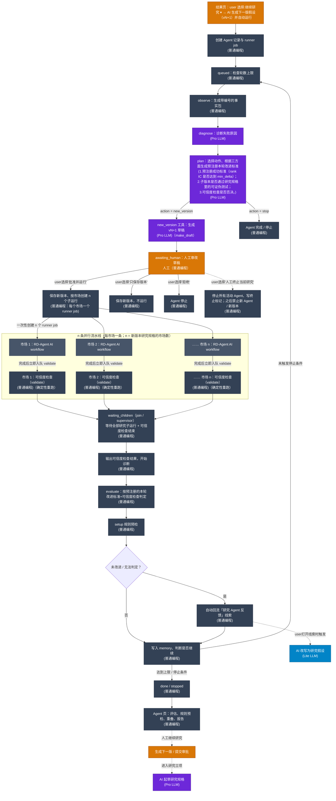

# 研究迭代 Agent 演示脚本（WF-02）

> 适用版本：2026-11-15。演示数据使用 runtime 中已完成的 Agent `agt_20261114181750_cdfa`；
> 不需要重跑 UK（UK 单轮约 17 分钟，演示时不要现场等待）。

## 0. 预置条件

```powershell
docker compose -f docker-compose.yml -f compose.local.yml --profile platform --profile research up -d
```

- Web：<http://localhost:18080>
- Vite 热更新：<http://localhost:5173>
- Agent 列表：<http://localhost:18080/agents>
- 固定演示 Agent：<http://localhost:18080/agents/agt_20261114181750_cdfa>

演示用固定记录：

| 项 | 值 |
|---|---|
| 根研究 | `hk_uk_fr_tone_cntp_interaction` v1 |
| Agent 当前版本 | v3 |
| 评估 | `not_improved` |
| 规则预检 | 阻断 0 / 警告 3 / 提示 4 |
| 自动回流线索 | `idea_20261114202859_963f`（渠道：研究 Agent 反馈） |
| 子运行 | HK / UK / FR 各 2 轮 + 3 个可信度检查 |

---

## 0.1 新 Agent 工作流与模型分工

模型由 `.env` 控制：

- **Pro LLM** = `FACTOPIA_LLM_MODEL`，当前为 `qwen3.8-max-0902`（复杂任务）
- **Lite LLM** = `FACTOPIA_LLM_LITE_MODEL`，当前为 `deepseek-v4.1-flash`（简单任务）
- **普通编程** = 确定性代码 / 文件 / 队列，不调用大模型
- **人工** = 页面上的审改、批准、终止等人工操作



**说明：**

- 图中 `action = new_version` 是主演示路径；Planner 也允许 `run_rdagent` / `run_text` / `validate` / `diagnose` / `stop`，这些动作由普通编程 / runner 执行，不额外调用 Pro/Lite 模型；其中 `run_rdagent` / `run_text` 的子任务内部使用 RD-Agent 的 `CHAT_MODEL`。
- 人工批准并运行后，会**按研究规格的市场数 n 一次性创建 n 个 runner job**（每个市场一条独立 RD-Agent workflow）。每个市场的 RD-Agent 完成后，runner 立即为该市场入队可信度检查（validate）；因此 n 条「RD-Agent → validate」流水线并行推进，validate 可以和其它市场的 RD-Agent / validate 重叠执行。所有 job 共用 runner 并发池（默认 3 个槽），超出排队。
- Agent 进入 `waiting_children`，作为 join / supervisor 等待全部研究子运行 + 可信度检查结束，不占 runner 运行槽；没有采纳轮次的市场不会创建 validate。
- 草稿是在人工闸门**之前**由 Pro LLM 生成的；人工批准后才保存版本并创建子运行。
- `evaluate`、规则预检、重叠 / 互补、报告、去重与记忆全部是确定性代码，不调用大模型。
- 自动回流线索的创建是(普通编程)；打开该线索时，前端会请求 AI 改写为研究假设，使用 Lite LLM。
- 「终止当前研究」可以在结果页或 Agent 页随时执行；图中只画在人工闸门处作为示例。终止会停止所有活动 Agent，并禁止该研究再启动 Agent 或生成新版本。

### 模型分工速查

| 步骤 / 任务 | 执行方式 | 模型 |
|---|---|---|
| 结果页「AI 生成下一版假设（vN+1）并自动运行」入口 | 人工操作 | 无 AI |
| 创建 Agent 与 runner job | (普通编程) | 无 AI |
| queued / 轮数检查 | (普通编程) | 无 AI |
| observe 事实包 | (普通编程) | 无 AI |
| diagnose 诊断 | AI | **Pro LLM** |
| plan 规划与预注册标准 | AI | **Pro LLM** |
| new_version 生成 vN+1 草稿 | AI | **Pro LLM** |
| 人工审改、批准 / 拒绝 / 终止 | 人工 | 无 AI |
| 保存版本、按市场创建 n 个子运行 | (普通编程) | 无 AI；每个市场一个 runner job |
| RD-Agent 子运行 × n（每市场一条） | 外部运行 | RD-Agent 的 `CHAT_MODEL`（不是 Pro/Lite）；runner 按并发上限调度（当前最多 3 个） |
| waiting_children（join / supervisor） | (普通编程) | 无 AI；等待全部研究子运行 + 可信度检查结束，不占 runner 运行槽 |
| 可信度检查（validate）× n | (普通编程)（确定性重跑） | 无 AI；每个市场 RD-Agent 完成后立即入队，n 条流水线并行（受 runner 并发上限 3 约束） |
| 导出、补诊断 | (普通编程) | 无 AI |
| evaluate 评估 | (普通编程)（确定性指标） | 无 AI |
| setup 规则预检 | (普通编程) | 无 AI |
| 自动回流线索 | (普通编程) | 无 AI |
| 打开回流线索并 AI 改写研究假设 | AI | **Lite LLM** |
| 因子库重叠 / 互补结论 | (普通编程)（`portfolio.combine`） | 无 AI |
| 迭代报告 | (普通编程) | 无 AI |
| 结果页「生成下一版」的 AI 起草 | AI | **Pro LLM** |
| 语义检索查询改写 | AI | **Lite LLM** |
| 术语表候选建议 | AI | **Lite LLM** |
| 公告标注 / 检索摘要 / AI 解释 | AI | **Pro LLM** |
| 线索 AI 建议 / 合并 / 论文因子抽取 | AI | **Pro LLM** |

---

## 1. 主演示：负结果如何闭环（约 3 分钟）

### 1.1 打开 Agent 页

打开：

```
http://localhost:18080/agents/agt_20261114181750_cdfa
```

展示：

1. 顶部状态 **已停止**；根研究、当前版本 v3、费用、审批人；
2. **子运行表（6 行）**：3 个 RD-Agent 运行 + 3 个可信度检查，状态与运行编号；
3. **评估面板**：`not_improved`，父/子版本 rank IC、扣成本收益、最大回撤；
4. **规则预检**：阻断 0 / 警告 3 / 提示 4，建议审批路径；
5. **因子库重叠**：当前 v3 与历史/已获批版本的相关性，≥0.7 标红“冗余”，并给出互补结论；
6. **下一步**：查看结果 / 基于 v3 继续研究 / 查看已自动回流的线索 / 提交审批；次级入口规则预检、构建组合与报告。

### 1.2 展示自动线索回流

点击 **查看已自动回流的线索**，或打开：

```
http://localhost:18080/ideas?id=idea_20261114202859_963f
```

说明：

- 渠道：**研究 Agent 反馈**（自动渠道，平台自动提交）；
- 来源：`hk_uk_fr_tone_cntp_interaction.v3` + 运行 `hk_h20_20261114183512`；
- Agent 没有自动开新研究；线索池是人工决定是否转立项的入口。

### 1.3 展示治理交接

从 Agent 页依次指向：

| 入口 | 预期 |
|---|---|
| 规则预检 | 风控台自动选中 `id=hk_uk_fr_tone_cntp_interaction&v=3`，显示两次预检 |
| 构建组合与报告 | 组合台自动选中 v3；可构建组合、生成报告 |
| 提交审批 | 审批台自动选中 v3；前置条件未满足时会列出缺项 |
| 查看结果 | 结果页打开该市场运行，可查看逐轮、诊断、可信度 |

**一句话总结：** Agent 负责观察、诊断、规划、运行、可信度检查、评估和回流线索；规则、组合、报告、审批仍由平台确定性工具与人工完成。

---

## 2. 完整正向演示（可选，约 15–30 分钟）

UK 慢，建议用**单市场研究**做现场演示，例如 `hk_vol_price_divergence_reversal`。

1. 结果页选一个已完成运行 → 研究结论右上角 **继续研究 ▾ → AI 生成下一版假设（vN+1）并自动运行**；
2. Agent 页先停在 **等待人工批准**，展示 vN+1 草稿；
3. 在草稿编辑器里改标题/假设，点击 **批准并运行**；
4. 观察阶段 toast：
   - 已批准，正在启动子任务…（脉冲）
   - 子任务已启动，自动滚到子运行表；运行编号列高亮
   - 子任务已完成，准备/正在可信度检查…
   - 可信度检查完成，Agent 正在评估…
   - 评估完成：改进 / 未改进，附下一步；
5. 子任务运行中：状态徽标 flash；失败行淡红；运行编号可点进运行页；
6. 评估完成后走第 1.2、1.3 节。

注意：`new_version` 会按研究规格的市场运行；三个市场时费用和时长约为单市场的 2–3 倍。

---

## 3. 红队测试

```powershell
docker compose -f docker-compose.yml -f compose.local.yml run --rm app python -m unittest tests.test_agents_p1 -v
```

Agent 相关红队用例：

| 用例 | 验证 |
|---|---|
| `test_redteam_ignores_context_leak_runs` | 受数据泄漏影响的运行不进入事实包 |
| `test_redteam_plan_rejects_unavailable_tool` | Planner 不能选择白名单外的工具 |
| `test_redteam_act_requires_approval` | 未批准不能保存/运行新版本 |
| `test_redteam_approve_requires_awaiting_state` | 非 `awaiting_human` 状态不能批准 |
| `test_redteam_budget_stops` | 超出预算会停止 |
| `test_redteam_stop_cancels_children` | 中止 Agent 会取消子任务 |
| `test_redteam_diagnosis_drops_unbacked_injection` | 无有效事实引用的结论被丢弃 |

另：

- 测试期 / holdout 数值不进入决策事实（P0 `test_observe_facts_are_redacted`）；
- 同一草稿重复批准只保留一个版本（`test_approve_retry_reuses_saved_version`）；
- 自动回流线索按 Agent/轮次/结论去重（`test_agent_feedback_is_idempotent`）。

---

## 4. 演示边界（评委可能会问）

| 问题 | 回答 |
|---|---|
| Agent 会自动批准/发布吗？ | 不会。保存新版本必须人工批准；审批台与信号目录仍由人操作。 |
| Agent 会自己新建研究/线索吗？ | 不新建研究；评估未改进/无法判定时自动回流一张“研究 Agent 反馈”线索，是否转立项由人决定。 |
| 决策会用测试期数据吗？ | 决策事实只用验证期及以前；测试期/未见数据只由确定性可信度检查使用，Agent 只看状态与定性结论。 |
| 为什么 v2 是孤儿版本？ | 第一次批准先保存 v2、后在写 approval.json 时因权限失败；第二次保存 v3。已修：重试同一草稿会复用已保存版本，不再生成 v4。 |
| 为什么不直接用 LangGraph？ | 平台已有 runner/job 检查点与中断恢复；状态机 + 文件状态更易审计，不新增依赖。 |
